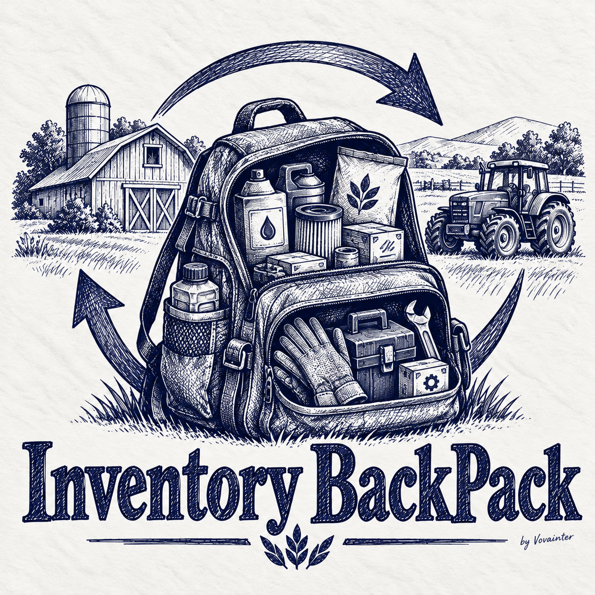

# Inventory BackPack for Multiplayer — Рюкзак для Farming Simulator 25

**Последний опубликованный релиз:** [v1.0.0.1](https://github.com/Vovainter-modding/FS25_InventoryBackPack/releases/latest)  
**Автор:** Vovainter  
**Игра:** Farming Simulator 25 (ПК)  
**Режим:** Одиночная игра и мультиплеер, включая dedicated-серверы

**[⬇ Скачать последнюю готовую сборку](https://github.com/Vovainter-modding/FS25_InventoryBackPack/releases/latest)**

## Что нового в релизе v1.0.0.1

- Переработана обработка клавиш `I` и `Y`, чтобы уменьшить конфликты с управлением техникой.
- В последнюю тестовую сборку добавлено автоматическое переключение интерфейса на **русский, английский и немецкий** языки.
- Работа клавиш на выделенных серверах продолжает тестироваться. О повторяющихся конфликтах сообщайте в Issues.

**Об исходниках:** Ветка `main` пока содержит исходный снимок кода версии v1.0.0.0. Готовый игровой ZIP последнего релиза находится в **Releases**. Старые `modDesc.xml` и Lua-файлы в `main` не следует путать с актуальной сборкой.

## О моде

Inventory BackPack добавляет каждому игроку личный рюкзак для небольших переносимых предметов. Фильтры, смазочные шприцы, расходники, канистры и другие подходящие объекты можно брать с собой, вместо того чтобы оставлять их у магазина или в мастерской.

**Тракторы, грузовики, прицепы и навесная техника в рюкзак не помещаются.** Совместимость предметов из других модов зависит от того, поддерживают ли они переносимость и постоянные идентификаторы FS25.

## Возможности

- Индивидуальный рюкзак у каждого игрока на сервере.
- **15 мест** в сетке **5 × 3** — предметы видны сразу, без карусели.
- Одинаковые предметы могут объединяться в интерфейсе и показывать количество `×N`.
- Выбор мышью или стрелками; Enter — извлечение выбранного предмета.
- Сохранение принадлежности вещей игрокам в `InventoryBackPack.xml` конкретной сохранки.
- При извлечении возвращается тот же игровой объект с его конфигурацией.
- Поддержка подходящих расходников из других модов.

## Управление

| Клавиша | Действие |
| --- | --- |
| `I` | Открыть/закрыть рюкзак вне техники |
| `Y` | Положить подходящий предмет, на который наведён прицел |
| Стрелки | Выбрать предмет |
| `Enter` | Выложить выбранный предмет |
| Мышь | Выбор ячейки |
| `Esc` | Закрыть окно |

## Установка

1. Открой раздел [Releases](../../releases) и скачай **`FS25_InventoryBackPack_for_Multiplayer.zip`** (не автоматический архив `Source code` от GitHub).
2. Положи ZIP **без распаковки** в папку `Documents/My Games/FarmingSimulator2025/mods` либо в свою активную папку модов.
3. Для сетевой игры установи **одинаковую версию** ZIP на сервер и компьютеры игроков.
4. Активируй мод в нужной сохранке.
5. Сделай резервную копию сохранки перед обновлением или установкой на основной сервер.

## Сохранение данных

Файл `InventoryBackPack.xml` хранится в папке соответствующей сохранки и содержит привязку предметов к их владельцам. Предметы должны иметь постоянный идентификатор; иначе мод может не принять их в рюкзак.

**Важно:** проект продолжает тестироваться. Совместимость с нестандартными предметами и восстановление содержимого после перезапуска сервера проверяй сначала на резервной копии.

## Сообщения об ошибках

Создавай [Issue](../../issues) и указывай версию мода, тип игры (SP/MP), точные шаги воспроизведения и соответствующие строки клиентского либо серверного `log.txt`. Если проблема с предметом другого мода, укажи его название.

Не публикуй в логах пароли, токены и другую личную информацию.

## Автор

**Vovainter**. Farming Simulator является товарным знаком GIANTS Software. Мод создан независимо от GIANTS Software.

## Лицензия

Лицензия на свободное использование кода пока не выбрана. Публичный доступ к репозиторию сам по себе не означает разрешения на копирование, изменение и распространение кода без согласия автора.
